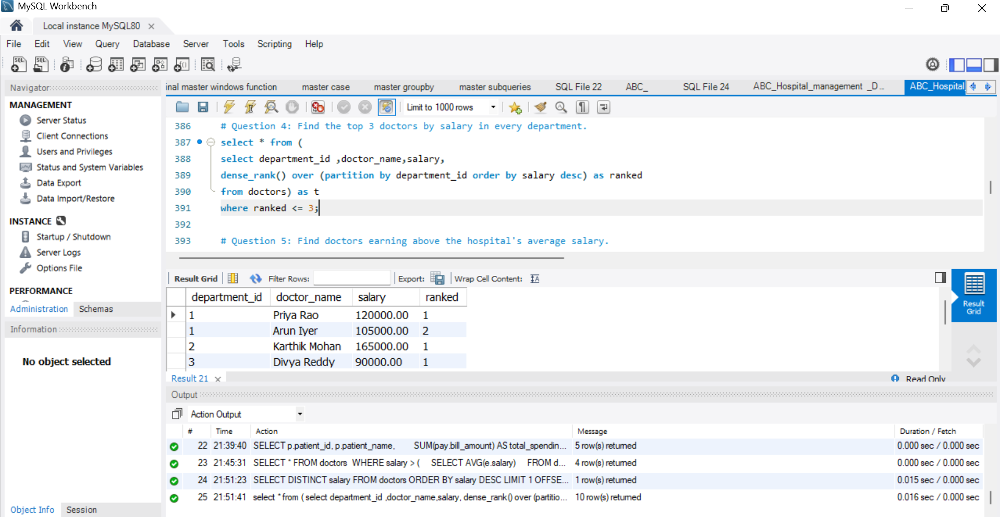
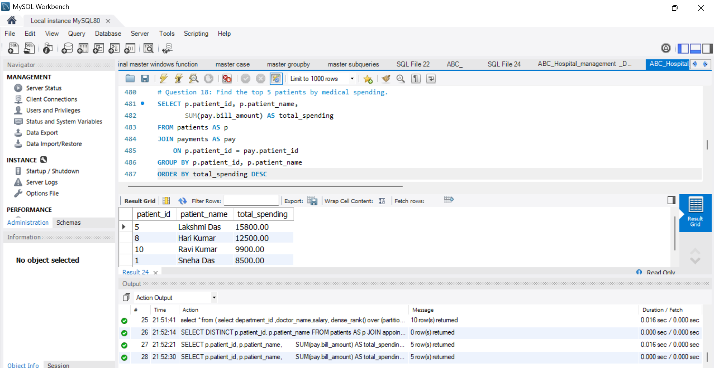
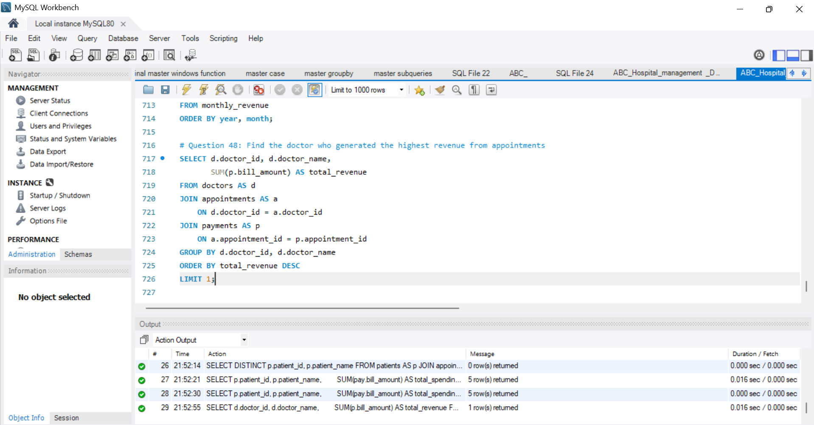

# ABC Multispeciality Hospital Data Analysis

## 📌 Project Overview

This project uses **MySQL** to analyze a sample hospital database and answer practical questions about hospital operations, doctor performance, patient spending, and revenue.

The project demonstrates how SQL can be used to organize data, calculate key metrics, and generate insights that support data-driven decisions.

> **Dataset disclaimer:** This project is for learning and portfolio demonstration. Ensure that only synthetic or otherwise authorized, non-sensitive data is included in the public repository.

## 🎯 Project Objectives

- Analyze hospital data using SQL.
- Explore doctor performance and salary information.
- Identify patients with the highest spending.
- Analyze hospital revenue.
- Practice writing queries that answer business questions.

## 🗄️ Database Tables

The database contains hospital-related tables covering areas such as patients, doctors, appointments, billing, and other hospital operations. Refer to the SQL file in this repository for the exact table definitions and relationships.

## 🛠️ Tools and Skills

- **Database:** MySQL
- **SQL concepts:** `SELECT`, `WHERE`, `ORDER BY`, `GROUP BY`, aggregate functions, joins, subqueries, and other analysis queries included in the SQL file.

## 📊 Selected SQL Analysis Screenshots

### Top Doctors by Salary

### Top Patients by Spending

### Highest Revenue Doctor

## 🚀 How to Run

1. Download or clone this repository.
2. Open MySQL Workbench and connect to your MySQL server.
3. Open the SQL file in this repository.
4. Review the script, then execute the database/table creation and data-loading statements as appropriate.
5. Run the analysis queries to explore the results.

> **Tip:** Check the SQL file before running it, especially if you already have databases with the same names. Back up any important data first.

## 💡 What I Learned

- Writing SQL queries to answer business questions.
- Summarizing and comparing data using aggregate functions.
- Analyzing doctor performance, patient spending, and revenue.
- Presenting query results clearly with screenshots.

## ⚠️ Disclaimer

This is an educational portfolio project, not a clinical or operational decision-making system. Do not upload real patient-identifiable or confidential hospital data to a public repository.

## 👩‍💻 Author

**Kiruthiga Narayanasamy**

Aspiring Data Analyst | MySQL | SQL Analytics
